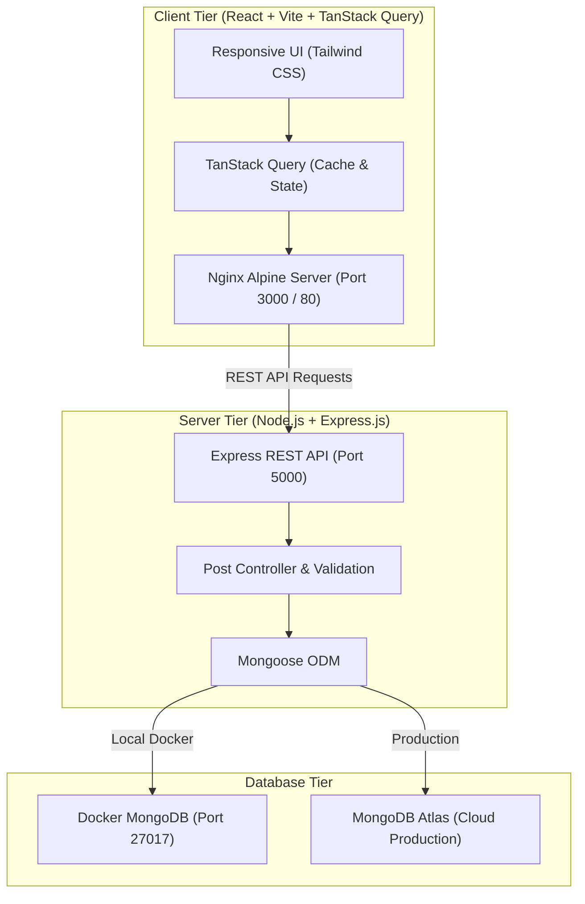

# CloudBlog: MERN Stack Blog Application

[](https://github.com)
[](https://www.docker.com)
[](https://docs.docker.com/compose/)
[](https://cloud.google.com/run)
[](https://react.dev)
[](https://tanstack.com/query)

A production-ready full-stack **MERN (MongoDB, Express.js, React.js, Node.js)** Blog Application containerized with **Docker**, orchestrated using **Docker Compose**, and equipped with automated **GitHub Actions CI/CD** pipelines deploying to **Google Cloud Run** and **MongoDB Atlas**.

---

## 🏗️ Architecture Overview



---

## 📁 Repository Structure

```
mern-blog-app/
├── backend/
│   ├── src/
│   │   ├── config/db.js              # MongoDB connection & reconnect logic
│   │   ├── controllers/postController.js # CRUD handlers & health probe
│   │   ├── middleware/               # Centralized error handling & validation
│   │   ├── models/Post.js            # Mongoose schema
│   │   ├── routes/postRoutes.js      # Express router
│   │   ├── app.js                    # Express app & middleware
│   │   └── server.js                 # Server listener & graceful shutdown
│   ├── tests/
│   │   └── post.test.js              # Jest + Supertest integration tests
│   ├── .dockerignore                 # Docker exclusion list
│   ├── Dockerfile                    # Multi-stage lightweight Node 20 alpine
│   ├── eslint.config.mjs             # ESLint 9 flat configuration
│   └── package.json
│
├── frontend/
│   ├── src/
│   │   ├── api/postsApi.js           # Axios client configured for proxy/cloud
│   │   ├── components/               # Navbar, PostCard, PostForm, Notification
│   │   ├── pages/                    # HomePage, PostDetailPage, Create, Edit
│   │   ├── index.css                 # Tailwind CSS styles
│   │   ├── App.jsx                   # QueryClientProvider & React Router
│   │   └── main.jsx
│   ├── nginx.conf                    # Nginx SPA router & asset caching
│   ├── .dockerignore
│   ├── Dockerfile                    # Multi-stage build (Vite -> Nginx Alpine)
│   ├── eslint.config.js
│   ├── package.json
│   └── vite.config.js
│
├── .github/
│   └── workflows/
│       ├── ci.yml                    # Automated tests & linting on push/PR
│       └── cd.yml                    # Docker Hub build/push & Cloud Run deployment
│
├── docker-compose.yml                # Multi-container orchestration
├── seed.js                           # Sample blog posts seeder script
├── .env.example                      # Root environment variables reference
├── README.md                         # Project documentation
└── REPORT.md                         # Academic assignment submission report
```

---

## 🚀 Quick Start (Local Development)

### Prerequisites
- [Node.js (v20+)](https://nodejs.org/)
- [Docker Desktop](https://www.docker.com/products/docker-desktop/) (for containerized execution)
- [Git](https://git-scm.com/)

### 1. Run with Docker Compose (Recommended)

To start the entire containerized stack (Frontend, Backend, and MongoDB) with a single command:

```bash
docker compose up --build
```

- **Frontend Application**: `http://localhost:3000`
- **Backend API**: `http://localhost:5000/api/posts`
- **API Health Check**: `http://localhost:5000/api/health`
- **MongoDB**: `localhost:27017`

To stop the containers and keep database volume data:
```bash
docker compose down
```

To remove all containers and reset volumes:
```bash
docker compose down -v
```

---

### 2. Run Locally Without Docker (Direct Node.js)

#### Start Backend:
```bash
cd backend
npm install
npm run dev
```

#### Start Frontend:
```bash
cd frontend
npm install
npm run dev
```
Open [http://localhost:3000](http://localhost:3000) in your browser.

#### (Optional) Seed Sample Articles:
```bash
node seed.js
```

---

## 🧪 Automated Testing & Code Quality

### Backend Tests
```bash
cd backend
npm test
```
Runs 10 comprehensive Jest & Supertest integration tests covering all CRUD endpoints, health check, and error handlers.

### Code Linting
```bash
# Lint Backend:
cd backend && npm run lint

# Lint Frontend:
cd frontend && npm run lint
```

### Production Build
```bash
cd frontend
npm run build
```

---

## 🐳 Docker Containerization Details

### Backend Dockerfile (`backend/Dockerfile`)
- Uses official lightweight `node:20-alpine`.
- Implements Docker layer caching by copying `package*.json` before source code.
- Runs under unprivileged `node` user for least-privilege security.
- Contains built-in `HEALTHCHECK` probe.

### Frontend Dockerfile (`frontend/Dockerfile`)
- Multi-stage build pattern:
  - **Stage 1 (Builder)**: Uses `node:20-alpine` to compile React JSX into optimized production assets via Vite.
  - **Stage 2 (Runner)**: Uses `nginx:alpine` (under 25MB) to serve static assets with gzip compression and client-side SPA routing (`try_files $uri $uri/ /index.html;`).

---

## ☁️ Cloud Deployment to Render.com & MongoDB Atlas

### 1. MongoDB Atlas Setup (100% Free Database Tier)
1. Create a free M0 cluster at [mongodb.com/atlas](https://www.mongodb.com/atlas).
2. Under **Database Access**, create a user (e.g. `bloguser` / `<password>`).
3. Under **Network Access**, allow access from anywhere (`0.0.0.0/0`) for cloud instances.
4. Copy the connection URI:
   ```
   mongodb+srv://bloguser:<password>@cluster0.mongodb.net/blogdb?retryWrites=true&w=majority
   ```

### 2. 1-Click Deployment to Render.com (100% Free - No Credit Card Required)

Render natively reads the included `render.yaml` blueprint to provision both backend and frontend:

1. Sign up / Log in to [Render.com](https://render.com) using your GitHub account.
2. Click **New +** > **Blueprint**.
3. Connect your repository: `anushkabera-02/mern-blog-app`.
4. Render will parse `render.yaml` and configure:
   * **`mern-blog-backend`**: Node.js Web Service (Port 10000).
   * **`mern-blog-frontend`**: React Vite Static Site with automatic SPA redirect rules.
5. In the environment variables prompt, enter your `MONGO_URI` from MongoDB Atlas.
6. Click **Apply**. In 2-3 minutes, you have live HTTPS production URLs!

### 3. Alternative 1-Click Frontend Deployment on Vercel
1. Log in to [Vercel](https://vercel.com) using GitHub.
2. Click **Add New... > Project** and import `mern-blog-app`.
3. Vercel automatically detects the included `vercel.json` file.
4. Set the environment variable: `VITE_API_URL` to your Render backend API URL.
5. Click **Deploy**.

---

## ⚙️ GitHub Actions CI/CD Pipeline

The project includes two automated workflows inside `.github/workflows/`:

1. **`ci.yml` (Continuous Integration)**:
   - Triggered on `push` and `pull_request` to `main` branch.
   - Installs dependencies with npm caching.
   - Executes ESLint validation on frontend and backend codebases.
   - Executes backend unit & integration tests with Jest & Supertest.
   - Validates that Vite builds successfully without errors.

2. **`cd.yml` (Continuous Delivery & Deployment)**:
   - Triggered automatically on merge to `main`.
   - Uses `docker/build-push-action` to build and push tagged images to Docker Hub.
   - Authenticates to Google Cloud using a Service Account Key.
   - Deploys container revisions to Google Cloud Run automatically.

### Required GitHub Repository Secrets

Configure the following secrets under **Settings > Secrets and variables > Actions**:

| Secret Name | Description | Example |
|---|---|---|
| `DOCKERHUB_USERNAME` | Docker Hub username | `johndoe` |
| `DOCKERHUB_TOKEN` | Docker Hub Personal Access Token | `dckr_pat_...` |
| `GCP_PROJECT_ID` | Google Cloud Project ID | `my-mern-app-2026` |
| `GCP_SA_KEY` | GCP Service Account JSON key content | `{"type": "service_account", ...}` |
| `MONGO_URI` | Production MongoDB Atlas URI | `mongodb+srv://...` |
| `GCP_REGION` | (Optional) Cloud Run region | `us-central1` |

---

## 📡 REST API Documentation

| Method | Endpoint | Description |
|---|---|---|
| `GET` | `/api/health` | Service uptime and MongoDB connection state |
| `GET` | `/api/posts` | Retrieve all posts (supports `?category=` & `?search=`) |
| `GET` | `/api/posts/:id` | Retrieve single post by ID |
| `POST` | `/api/posts` | Create new post (`title`, `content`, `author`, `category`, `tags`) |
| `PUT` | `/api/posts/:id` | Update existing post |
| `DELETE` | `/api/posts/:id` | Delete post by ID |

---

## 📄 License & Attribution

Developed for **CSE 3395: Web Application Projects with React** (Academic Year 2026–2027), B.Tech CSIT.
Licensed under the MIT License.
